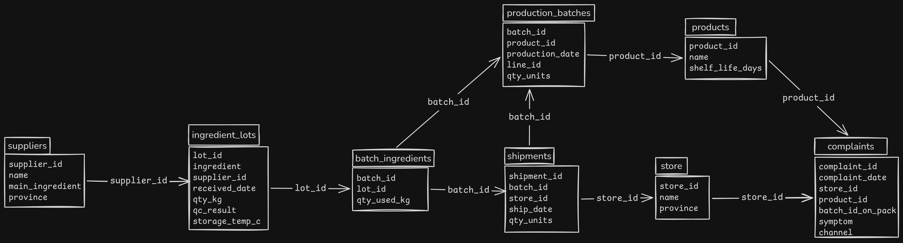
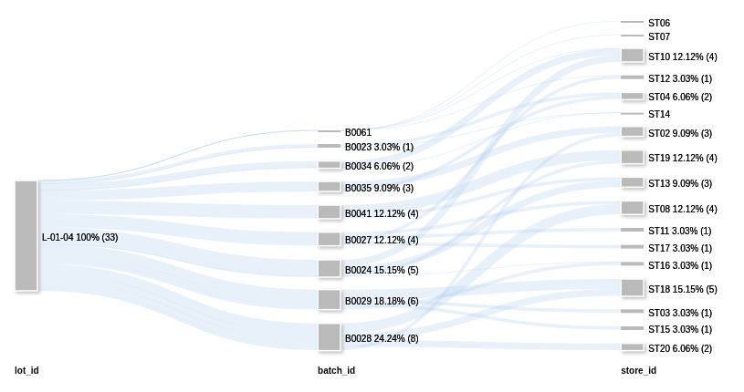

## ข้อที่ 1 โหลดและเชื่อมโยงข้อมูล
1. แผนภาพหรือคำอธิบายว่าตารางไหนเชื่อมกับตารางไหนด้วยคอลัมน์อะไร (วาดมือถ่ายรูปก็ได้)

	**ตอบ**
	
	
2. รายงานคุณภาพข้อมูลสั้น ๆ: มีข้อร้องเรียนกี่รายการที่ไม่มีรหัสล็อตผลิต, มีข้อมูลซ้ำหรือค่าว่างที่ไหนบ้าง, คุณจัดการอย่างไร

	**ตอบ** ไฟล์ suppliers, stores, products, ingredient_lots, production_batches, batch_ingredients, shipments มีข้อมูลครบถ้วนดี ไม่มีค่าว่างหรือข้อมูลซํ้า ส่วน ไฟล์ complaints ไม่มีข้อมูลซํ้าแต่มีค่าว่างที่คอลัมน์ **batch_id_on_pack** จำนวน 26 แถว ข้อมูลส่วนนี้ผมปล่อยให้มันเป็นค่าว่างไว้เหมือนเดิมเพราะว่าผมคิดว่าข้อมูลคอลัมน์อื่นก็ยังมีอยู่ครบและไม่ควรใส่ไปมั่วๆหากไม่มีแหล่งที่มายืนยันที่ชัดเจน
3. ตอบคำถามต่อไปนี้พร้อมโค้ด/query ที่ใช้:
    - **Q1.1** ล็อตผลิต B0028 ใช้วัตถุดิบล็อตใดบ้าง และถูกส่งไปร้านไหนบ้าง
    
        **ตอบ** ล็อตผลิต B0028 ใช้วัตถุดิบล็อต L-01-04, L-02-03, L-04-03 และ L-05-02 ถูกส่งไปร้านสะดวกซื้อสาขา ท่ารถในเมือง, เซ็นทรัลลาดพร้าว, เซ็นทรัลหาดใหญ่ และหมู่บ้านศรีราชา

        **Query**
	    ```sql
	    select bi.batch_id, il.lot_id, st.name
	    from batch_ingredients bi
	    inner join ingredient_lots il on bi.lot_id = il.lot_id
	    inner join shipments sm on bi.batch_id = sm.batch_id
	    inner join stores st on sm.store_id = st.store_id
	    where bi.batch_id = "B0028"
	    order by bi.lot_id ASC
	    ```
	    **ไฟล์ผลลัพธ์ CSV:** output/ex1q1p1.csv
    - **Q1.2** วัตถุดิบล็อต L-01-04 ถูกใช้ไปทั้งหมดกี่กิโลกรัม ในล็อตผลิตกี่ล็อต

        **ตอบ** วัตถุดิบล็อต L-01-04 ถูกใช้ไปทั้งหมด 500 กิโลกรัม ในล็อตผลิต 9 ล็อต

        **Query**
        ```sql
        select SUM(qty_used_kg) as total_used_kg, 
        COUNT(DISTINCT batch_id) AS batches
	    from batch_ingredients
	    where lot_id = "L-01-04"
        ```
	    **ไฟล์ผลลัพธ์ CSV:** output/ex1q1p2.csv
	- **Q1.3** ร้านค้าแต่ละสาขามีข้อร้องเรียนที่เป็น "อาการเจ็บป่วยหรือกลิ่น/รสผิดปกติ" กี่รายการ (ไม่นับเรื่องบรรจุภัณฑ์) เรียงจากมากไปน้อย

		**ตอบ** ร้านค้าแต่ละสาขามีข้อร้องเรียนที่เป็น "อาการเจ็บป่วยหรือกลิ่น/รสผิดปกติ" ดังนี้
        - ร้านสะดวกซื้อ สาขา หมู่บ้านศรีราชา 6 รายการ
        - ร้านสะดวกซื้อ สาขา ถนนป่าตอง 6 รายการ
        - ร้านสะดวกซื้อ สาขา เซ็นทรัลลาดพร้าว 5 รายการ
        - ร้านสะดวกซื้อ สาขา หมู่บ้านนิมมาน 4 รายการ
        - ร้านสะดวกซื้อ สาขา ท่ารถในเมือง 4 รายการ
        - ร้านสะดวกซื้อ สาขา ท่ารถในเมือง 4 รายการ
        - ร้านสะดวกซื้อ สาขา ท่ารถศรีราชา 4 รายการ
        - ร้านสะดวกซื้อ สาขา ตลาดบางนา 3 รายการ
        - ร้านสะดวกซื้อ สาขา เซ็นทรัลหาดใหญ่ 3 รายการ
        - ร้านสะดวกซื้อ สาขา เซ็นทรัลหาดใหญ่ 3 รายการ
        - ร้านสะดวกซื้อ สาขา เซ็นทรัลลาดพร้าว 2 รายการ
        - ร้านสะดวกซื้อ สาขา ตลาดสุขุมวิท 2 รายการ
        - ร้านสะดวกซื้อ สาขา หมู่บ้านมาบตาพุด 2 รายการ
        - ร้านสะดวกซื้อ สาขา เซ็นทรัลสุขุมวิท 1 รายการ
        - ร้านสะดวกซื้อ สาขา เซ็นทรัลในเมือง 1 รายการ
        - ร้านสะดวกซื้อ สาขา เซ็นทรัลบางนา 1 รายการ

        **Query**
        ```sql
		select st.store_id, st.name as store_name, count(c.complaint_id) as complaint_count 
		from stores st
		inner join complaints c on st.store_id = c.store_id 
		where c.symptom in ("ปวดท้องรุนแรง", "คลื่นไส้อาเจียน", "กลิ่นหืนผิดปกติ", "รสขมผิดปกติ", "ท้องเสียหลังรับประทาน")
		group by st.store_id
		order by complaint_count DESC
        ```
        **ไฟล์ผลลัพธ์ CSV:** output/ex1q1p3.csv

## ข้อ 2  หาล็อตวัตถุดิบต้นเหตุ และขอบเขตการเรียกคืน
1. ระบุล็อตวัตถุดิบต้นเหตุ 1 ล็อต พร้อม**หลักฐานเชิงตัวเลข** เช่น สัดส่วนล็อตผลิตที่ใช้วัตถุดิบล็อตนี้แล้วถูกร้องเรียน เทียบกับล็อตวัตถุดิบอื่น ๆ

	**ตอบ** ล็อตวัตถุดิบต้นเหตุ คือ ล็อต L-01-04 เพราะ จากข้อในฐานข้อมูลล็อตนี้มีการร้องเรียนอย่างน้อย 8 จาก 9 batches ซึ่งคิดเป็น 88 เปอร์เซ็น และจากบันทึกการร้องเรียนสินค้า สินค้าที่ถูกร้องเรียนมากที่สุดมี ขนมปังกรอบรสกะทิ คุกกี้กะทิ และโปรตีนบาร์ ซึ่ง 2 ใน 3 เป็นสินค้าที่มีส่วนผสมของกะทิซึ่งตรงกับวัตถุดิบในล็อต L-01-04 

	**ไฟล์ผลลัพธ์ CSV:** output/ex2q1.csv

2. อธิบายว่าทำไมล็อตวัตถุดิบอื่นที่ "ดูน่าสงสัย" (ปรากฏในล็อตผลิตที่มีปัญหาบ่อยเหมือนกัน) จึงไม่ใช่ต้นเหตุ

	**ตอบ** สาเหตุที่ล็อตวัตถุดิบอื่นดูน่าสงสัยเป็นเพราะมีการใช้วัตถุดิบในล็อตที่มีปัญหาเป็นส่วนประกอบในการสร้าง product จึงทำให้วัตถุดิบล็อตนั้นมีข้อร้องเรียนขึ้นมาด้วย

	**ไฟล์ผลลัพธ์ CSV:**  output/ex2q2.csv

3. รายการล็อตผลิตทั้งหมดที่ใช้วัตถุดิบล็อตต้นเหตุ และรายการร้านค้าทั้งหมดที่ต้องเรียกคืนสินค้า พร้อมจำนวนชิ้นที่ส่งไปแต่ละร้าน **รวมถึงล็อตผลิต/ร้านที่ยังไม่มีข้อร้องเรียนเลย**

	**ตอบ** ล็อตผลิตทั้งหมดที่ใช้วัตถุดิบล็อตต้นเหตุมีล็อต B0023, B0024, B0027, B0028, B0029, B0034, B0035, B0041 และB0061 รวม 9 ล็อต **(ไฟล์ผลลัพธ์ CSV: output/ex2q3p1.csv)**

	ร้านค้าทั้งหมดที่ต้องเรียกคืนสินค้าและจำนวนชิ้นที่ส่งไปแต่ละร้าน ได้แก่
	- ร้านสะดวกซื้อ สาขา ท่ารถในเมือง ส่งไปจำนวน 1400 ชิ้น
	- ร้านสะดวกซื้อ สาขา หมู่บ้านนิมมาน ส่งไปจำนวน 1200 ชิ้น
	- ร้านสะดวกซื้อ สาขา ท่ารถในเมือง ส่งไปจำนวน 1000 ชิ้น
	- ร้านสะดวกซื้อ สาขา เซ็นทรัลลาดพร้าว ส่งไปจำนวน 1000 ชิ้น
	- ร้านสะดวกซื้อ สาขา เซ็นทรัลหาดใหญ่ ส่งไปจำนวน 1000 ชิ้น
	- ร้านสะดวกซื้อ สาขา หมู่บ้านศรีราชา ส่งไปจำนวน 1000 ชิ้น
	- ร้านสะดวกซื้อ สาขา เซ็นทรัลหาดใหญ่ ส่งไปจำนวน 800 ชิ้น
	- ร้านสะดวกซื้อ สาขา หมู่บ้านมาบตาพุด ส่งไปจำนวน 800 ชิ้น
	- ร้านสะดวกซื้อ สาขา เซ็นทรัลบางนา ส่งไปจำนวน 600 ชิ้น
	- ร้านสะดวกซื้อ สาขา ตลาดบางนา ส่งไปจำนวน 600 ชิ้น
	- ร้านสะดวกซื้อ สาขา ท่ารถศรีราชา ส่งไปจำนวน 400 ชิ้น
	- ร้านสะดวกซื้อ สาขา ท่ารถโคกกรวด ส่งไปจำนวน 400 ชิ้น
	- ร้านสะดวกซื้อ สาขา เซ็นทรัลสุขุมวิท ส่งไปจำนวน 400 ชิ้น
	- ร้านสะดวกซื้อ สาขา เซ็นทรัลลาดพร้าว ส่งไปจำนวน 400 ชิ้น
	- ร้านสะดวกซื้อ สาขา ถนนป่าตอง ส่งไปจำนวน 200 ชิ้น
	- ร้านสะดวกซื้อ สาขา เซ็นทรัลในเมือง ส่งไปจำนวน 200 ชิ้น
	- ร้านสะดวกซื้อ สาขา ตลาดสุขุมวิท ส่งไปจำนวน 200 ชิ้น
	รวมทั้งสิ้น 17 ร้าน มีสินค้าที่ส่งไปทั้งหมดจำนวน 11,600 ชิ้น **(ไฟล์ผลลัพธ์ CSV: output/ex2q3p2.csv)**

4. มีร้านค้าสาขาหนึ่งที่มีข้อร้องเรียนอาการผิดปกติจำนวนมาก แต่สินค้าที่ถูกร้องเรียน**ไม่ได้**ใช้วัตถุดิบล็อตต้นเหตุ จงระบุสาขานั้นและอธิบายสาเหตุโดยอ้างอิงเอกสารที่ให้

	**ตอบ** ร้านค้าสาขาหนึ่งที่มีข้อร้องเรียนอาการผิดปกติจำนวนมาก แต่สินค้าที่ถูกร้องเรียนไม่ได้ใช้วัตถุดิบล็อตต้นเหตุ คือ ร้านสะดวกซื้อ ST07 สาขา ถนนป่าตอง สาเหตุมาจากตู้ควบคุมอุณหภูมิสำหรับเก็บสินค้าสำรองของสาขาชำรุดแล้วพนักงานไม่ได้แจ้งซ่อม ทำให้สินค้าหลายรายการถูกเก็บในอุณหภูมิสูงจึงทำให้เกิดการเสื่อมสภาพของสินค้าได้

	**ไฟล์ผลลัพธ์ CSV:**  output/ex2q4.csv

5. ใช้เอกสาร `docs/` อธิบายว่าทำไมวัตถุดิบล็อตนั้นจึงมีปัญหา (เกิดอะไรขึ้นกับมัน)

	**ตอบ** สาเหตุที่วัตถุดิบล็อต L-01-04 มีปัญหาเพราะวัตถุดิบล็อตนี้ถูกเก็บไว้ในห้องเก็บวัตถุดิบแห้งโซน C ซึ่งในช่วงวันที่ 12 ถึง 15 เมษายน 2568 เครื่องปรับอากาศของห้องเก็บวัตถุดิบแห้งโซน C ขัดข้อง โดยอุณหกูมิในห้องสูงถึง 27-28 องศาเซลเซียส สินค้าจึงไม่ได้เก็บในอุณหภูมิที่เหมาะสมทำให้สินค้าเสื่อมสภาพ

## ข้อ 3 เขียนบันทึกสรุปสำหรับผู้บริหาร
**ตอบ** ให้ LLM เขียนบันทึกให้โดยแนบไฟล์ "ex2q3p2.csv", "01_บันทึก_QA_สรุปข้อร้องเรียน.txt" และใช้ Prompt ดังนี้

>คุณคือผู้เชี่ยวชาญด้าน QA และความปลอดภัยอาหารของโรงงานผลิตขนมและอาหารแห้ง จงเขียนบันทึกข้อความถึงผู้จัดการโรงงาน โดยใช้เฉพาะข้อมูลที่แนบมา (ไฟล์ ex2q3p2.csvซึ่งเป็นไฟล์ข้อมูลร้านค้าและจำนวนสินค้าที่ต้องเรียกคืน, 01_บันทึก_QA_สรุปข้อร้องเรียน.txt และข้อความต้นเหตุด้านล่าง) ห้ามเดาหรือเพิ่มข้อมูลเอง หากไม่มีข้อมูลให้ระบุว่า "ไม่มีข้อมูล"
>
>สถานการณ์: ลูกค้าร้องเรียนอาการท้องเสีย คลื่นไส้ และกลิ่นผิดปกติเพิ่มขึ้นผิดปกติ ฝ่าย QA สงสัยว่าวัตถุดิบบางล็อตเสื่อมสภาพ แต่ไม่ทราบล็อตและไม่ทราบว่าสินค้ากระจายไปที่ร้านใดบ้าง
>
>ต้นเหตุ: วัตถุดิบล็อต L-01-04 ถูกเก็บในห้องเก็บวัตถุดิบแห้งโซน C ซึ่งระหว่างวันที่ 12-15 เมษายน 2568 เครื่องปรับอากาศขัดข้อง อุณหภูมิห้องสูงถึง 27-28 องศาเซลเซียส วัตถุดิบจึงเสื่อมสภาพ  
เนื้อหาที่ต้องครอบคลุม (ตามลำดับ): (1) เกิดอะไรขึ้น (2) ต้นเหตุ (3) สิ่งที่ต้องเรียกคืน: ร้านค้า สินค้า จำนวน และยอดรวม จากไฟล์ CSV (4) ข้อเสนอแนะการดำเนินการต่อ เช่น กักกันสินค้าคงเหลือ แจ้งร้านค้านำสินค้าออกจากชั้นวาง ซ่อมระบบปรับอากาศ และมาตรการป้องกัน
>
>การอ้างอิง: ทุกตัวเลขและข้อเท็จจริงต้องระบุที่มากำกับ ใช้รูปแบบ [ชื่อไฟล์ › ย่อหน้า n] สำหรับเอกสารข้อความ และ [ชื่อไฟล์.csv › คอลัมน์/เงื่อนไขที่ใช้] สำหรับ CSV ข้อเสนอแนะไม่ต้องอ้างอิง แต่ต้องแยกจากข้อเท็จจริงให้ชัดเจน
>
>รูปแบบ: ภาษาไทยทางการ เขียนเป็นพารากราฟต่อเนื่อง ไม่ใช้ตาราง บูลเล็ต หรือรายการตัวเลข ยาวไม่เกิน 1 หน้า A4 (ประมาณ 350-450 คำ) เฉพาะข้อมูลที่จำเป็น มีส่วนหัว เรื่อง เรียน จาก วันที่ หากข้อมูลในไฟล์ไม่สอดคล้องกับต้นเหตุ ให้แจ้งในหมายเหตุท้ายบันทึก

**บันทึกข้อความถึงผู้จัดการโรงงาน**

```
บันทึกข้อความ

เรื่อง สรุปสถานการณ์ข้อร้องเรียนและรายการสินค้าที่ต้องเรียกคืน  
เรียน ผู้จัดการโรงงาน  
จาก ทีมข้อมูล

สิ่งที่เกิดขึ้น
ตั้งแต่ปลายเดือนเมษายน 2568 ฝ่ายลูกค้าสัมพันธ์ได้รับข้อร้องเรียนเรื่องท้องเสีย คลื่นไส้ และกลิ่นหืนผิดปกติ เพิ่มขึ้นประมาณ 4 เท่าของค่าเฉลี่ยรายเดือน ส่วนใหญ่เกี่ยวข้องกับสินค้าที่มีส่วนผสมของกะทิผง [01_บันทึก_QA_สรุปข้อร้องเรียน.txt › ย่อหน้า 1] สินค้าที่ถูกร้องเรียนมากที่สุดคือขนมปังกรอบรสกะทิ คุกกี้กะทิ และโปรตีนบาร์ ประมาณหนึ่งในสี่ของข้อร้องเรียนไม่มีรหัสล็อตเพราะลูกค้าทิ้งซองไปแล้ว [01_บันทึก_QA_สรุปข้อร้องเรียน.txt › ย่อหน้า 2] ฝ่าย QA ตรวจตัวอย่างเก็บไว้แล้วพบค่า Peroxide value สูงกว่ามาตรฐาน 5 จาก 6 ตัวอย่าง ซึ่งสอดคล้องกับวัตถุดิบประเภทไขมันที่เสื่อมสภาพ [01_บันทึก_QA_สรุปข้อร้องเรียน.txt › ย่อหน้า 3]

ต้นเหตุ
วัตถุดิบล็อต L-01-04 ถูกเก็บในห้องเก็บวัตถุดิบแห้งโซน C ระหว่างวันที่ 12 ถึง 15 เมษายน 2568 เครื่องปรับอากาศของห้องนี้ขัดข้อง อุณหภูมิสูงถึง 27 ถึง 28 องศาเซลเซียสประมาณ 3 วันก่อนซ่อมแซม [01_บันทึก_QA_สรุปข้อร้องเรียน.txt › ย่อหน้า 4] วัตถุดิบจึงเสื่อมสภาพ

สิ่งที่ต้องเรียกคืน
ไฟล์ข้อมูลระบุ 17 รายการ รวม 11,600 หน่วย [ex2q3p2.csv › นับแถว และผลรวมคอลัมน์ total_units] จำแนกเป็นโปรตีนบาร์ 5,600 หน่วย ขนมปังกรอบรสกะทิ 4,600 หน่วย และคุกกี้กะทิ 1,400 หน่วย [ex2q3p2.csv › ผลรวม total_units จัดกลุ่มตาม product_name] ชื่อร้านทุกแห่งขึ้นต้นว่า "ร้านสะดวกซื้อ สาขา" ดังนี้

โปรตีนบาร์ 8 ร้าน ได้แก่ ST10 ท่ารถในเมือง 1,400 หน่วย ST19 หมู่บ้านนิมมาน 1,200 หน่วย ST13 เซ็นทรัลลาดพร้าว 1,000 หน่วย ST16 ตลาดบางนา และ ST03 เซ็นทรัลบางนา แห่งละ 600 หน่วย ST06 ท่ารถโคกกรวด 400 หน่วย ST15 ตลาดสุขุมวิท และ ST07 ถนนป่าตอง แห่งละ 200 หน่วย [ex2q3p2.csv › product_name = โปรตีนบาร์]

ขนมปังกรอบรสกะทิ 7 ร้าน ได้แก่ ST18 หมู่บ้านศรีราชา และ ST08 ท่ารถในเมือง แห่งละ 1,000 หน่วย ST12 หมู่บ้านมาบตาพุด และ ST02 เซ็นทรัลหาดใหญ่ แห่งละ 800 หน่วย ST20 เซ็นทรัลลาดพร้าว และ ST17 เซ็นทรัลสุขุมวิท แห่งละ 400 หน่วย ST11 เซ็นทรัลในเมือง 200 หน่วย [ex2q3p2.csv › product_name = ขนมปังกรอบรสกะทิ]

คุกกี้กะทิ 2 ร้าน ได้แก่ ST14 เซ็นทรัลหาดใหญ่ 1,000 หน่วย และ ST04 ท่ารถศรีราชา 400 หน่วย [ex2q3p2.csv › product_name = คุกกี้กะทิ]

ข้อเสนอแนะ
ทีมข้อมูลเสนอให้ดำเนินการตามลำดับต่อไปนี้ ขั้นแรก กักกันวัตถุดิบล็อต L-01-04 และสินค้าคงเหลือที่ผลิตจากล็อตนี้ทั้งหมดทันที ขั้นที่สอง แจ้งร้านค้าทั้ง 17 รายการให้นำสินค้าออกจากชั้นวางและรอรับคืน ขั้นที่สาม ให้ฝ่ายผลิตและฝ่าย QA ตรวจสอบย้อนกลับว่ามีสินค้าอื่นใช้วัตถุดิบล็อตนี้หรือไม่ เพื่อขยายขอบเขตการเรียกคืนหากจำเป็น ขั้นที่สี่ ซ่อมและตรวจสอบระบบปรับอากาศโซน C ให้ใช้งานได้เต็มประสิทธิภาพ สุดท้าย กำหนดมาตรการป้องกัน เช่น ติดตั้งระบบเตือนอุณหภูมิห้องเก็บวัตถุดิบ ตรวจวัดอุณหภูมิเป็นประจำ และกำหนดให้ตรวจคุณภาพวัตถุดิบก่อนใช้งานเมื่อเกิดเหตุอุณหภูมิผิดปกติ

ทีมข้อมูล
```

**วิธีตรวจสอบผลลัพธ์:** ตรวจสอบผลลัพธ์ด้วยการอ่านซํ้าด้วยตนเองพร้อมเช็คข้อมูลตามอ้างอิงที่ระบุไว้ จากการตรวจสอบไม่พบจุดใดที่ LLM เขียนผิด

## ข้อ 4 ภาพแสดงเส้นทางวัตถุดิบ
**ตอบ** 
**ไฟล์ข้อมูล CSV:** output/ex4.csv

## วิธีรัน
เริ่มจากถ่ายโอนไฟล์จาก CSV เข้าสู่ SQLite
```
uv run scripts/import_csv_to_db.py
```

จากนั้นรันคำสั่งตามหัวข้อต่างๆดังนี้

**โจทย์ข้อที่ 1 โหลดและเชื่อมโยงข้อมูล**

ข้อที่ 3

*Q1.1*
```
uv run scripts/ex1q1p1.py
```

*Q1.2*
```
uv run scripts/ex1q1p2.py
```

*Q1.3*
```
uv run scripts/ex1q1p3.py
```

**โจทย์ข้อที่ 2 หาล็อตวัตถุดิบต้นเหตุ และขอบเขตการเรียกคืน**

*ข้อที่ 1*
```
uv run scripts/ex2q1.py
```

*ข้อที่ 2*
```
uv run scripts/ex2q2.py
```

*ข้อที่ 3 ข้อมูลอันแรก*
```
uv run scripts/ex2q3p1.py
```

*ข้อที่ 3 ข้อมูลอันที่สอง*
```
uv run scripts/ex2q3p2.py
```

*ข้อที่ 4*
```
uv run scripts/ex2q4.py
```

**โจทย์ข้อที่ 4 ภาพแสดงเส้นทางวัตถุดิบ**

*ข้อมูลที่ใช้เพื่อนำไปสร้างภาพ*
```
uv run scripts/ex4.py
```

## สิ่งที่ทำได้
ทำได้ครบทุกข้อ
## สิ่งที่ทำไม่ทัน
ไม่มี
## ส่วนที่ใช้ AI ช่วย
- ให้ช่วยหาข้อมูลและสอนวิธีเขียนคำสั่งจากเครื่องมือที่ใช้
- ช่วยเขียนหรือแก้ไข SQL ตรงส่วนที่ไม่เข้าใจหรือคิดไม่ออก
- ช่วยหาข้อผิดพลาดจาก SQL ที่ทำงานไม่ตรงกับที่ต้องการ
- ช่วยเขียนรายงานให้ผู้จัดการโรงงาน
- ช่วยเขียนไฟล์ Schema สำหรับนำไปสร้างตารงในฐานข้อมูล