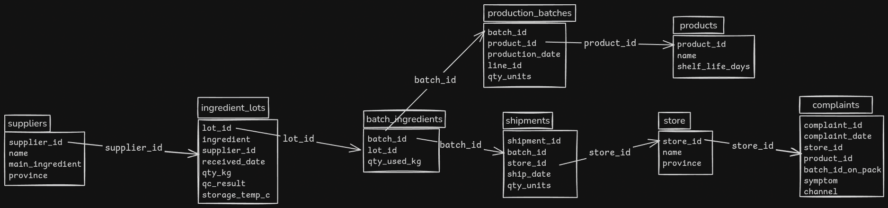

## ข้อที่ 1 โหลดและเชื่อมโยงข้อมูล
1. แผนภาพหรือคำอธิบายว่าตารางไหนเชื่อมกับตารางไหนด้วยคอลัมน์อะไร (วาดมือถ่ายรูปก็ได้)

	**ตอบ**


2. รายงานคุณภาพข้อมูลสั้น ๆ: มีข้อร้องเรียนกี่รายการที่ไม่มีรหัสล็อตผลิต, มีข้อมูลซ้ำหรือค่าว่างที่ไหนบ้าง, คุณจัดการอย่างไร

	**ตอบ** ไฟล์ suppliers, stores, products, ingredient_lots, production_batches, batch_ingredients, shipments มีข้อมูลครบถ้วนไม่มีค่าว่างหรือข้อมูลซํ้า ส่วน ไฟล์ complaints ไม่มีข้อมูลซํ้าแต่มีค่าว่างที่คอลัมน์ **batch_id_on_pack** จำนวน 26 แถว ข้อมูลส่วนนี้ผมปล่อยให้มันเป็นค่าว่างไว้เหมือนเดิมเพราะว่าผมคิดว่าข้อมูลคอลัมน์อื่นก็ยังมีอยู่ครบและไม่ควรใส่ไปมั่วๆหากไม่มีแหล่งที่มายืนยันที่ชัดเจน
3. ตอบคำถามต่อไปนี้พร้อมโค้ด/query ที่ใช้:
    - **Q1.1** ล็อตผลิต B0028 ใช้วัตถุดิบล็อตใดบ้าง และถูกส่งไปร้านไหนบ้าง
    
        **ตอบ** ล็อตผลิต B0028 ใช้วัตถุดิบล็อต L-01-04, L-02-03, L-04-03 และ L-05-02 ถูกส่งไปร้านสะดวกซื้อสาขา ท่ารถในเมือง, เซ็นทรัลลาดพร้าว, เซ็นทรัลหาดใหญ่ และหมู่บ้านศรีราชา

        **Query**
	    ```sql
	    select bi.batch_id, il.lot_id, st.name
	    from batch_ingredients bi
	    inner join ingredient_lots il on bi.lot_id = il.lot_id
	    inner join shipments sm on bi.batch_id = sm.batch_id
	    inner join stores st on sm.store_id = st.store_id
	    where bi.batch_id = "B0028"
	    order by bi.lot_id ASC
	    ```
	    **ไฟล์ผลลัพธ์ CSV:** output/ex1q1p1.csv
    - **Q1.2** วัตถุดิบล็อต L-01-04 ถูกใช้ไปทั้งหมดกี่กิโลกรัม ในล็อตผลิตกี่ล็อต

        **ตอบ** วัตถุดิบล็อต L-01-04 ถูกใช้ไปทั้งหมด 500 กิโลกรัม ในล็อตผลิต 9 ล็อต

        **Query**
        ```sql
        select SUM(qty_used_kg) as total_used_kg, 
        COUNT(DISTINCT batch_id) AS batches
	    from batch_ingredients
	    where lot_id = "L-01-04"
        ```
	    **ไฟล์ผลลัพธ์ CSV:** output/ex1q1p2.csv
	- **Q1.3** ร้านค้าแต่ละสาขามีข้อร้องเรียนที่เป็น "อาการเจ็บป่วยหรือกลิ่น/รสผิดปกติ" กี่รายการ (ไม่นับเรื่องบรรจุภัณฑ์) เรียงจากมากไปน้อย

		**ตอบ** ร้านค้าแต่ละสาขามีข้อร้องเรียนที่เป็น "อาการเจ็บป่วยหรือกลิ่น/รสผิดปกติ" ดังนี้
        - ร้านสะดวกซื้อ สาขา หมู่บ้านศรีราชา 6 รายการ
        - ร้านสะดวกซื้อ สาขา ถนนป่าตอง 6 รายการ
        - ร้านสะดวกซื้อ สาขา เซ็นทรัลลาดพร้าว 5 รายการ
        - ร้านสะดวกซื้อ สาขา หมู่บ้านนิมมาน 4 รายการ
        - ร้านสะดวกซื้อ สาขา ท่ารถในเมือง 4 รายการ
        - ร้านสะดวกซื้อ สาขา ท่ารถในเมือง 4 รายการ
        - ร้านสะดวกซื้อ สาขา ท่ารถศรีราชา 4 รายการ
        - ร้านสะดวกซื้อ สาขา ตลาดบางนา 3 รายการ
        - ร้านสะดวกซื้อ สาขา เซ็นทรัลหาดใหญ่ 3 รายการ
        - ร้านสะดวกซื้อ สาขา เซ็นทรัลหาดใหญ่ 3 รายการ
        - ร้านสะดวกซื้อ สาขา เซ็นทรัลลาดพร้าว 2 รายการ
        - ร้านสะดวกซื้อ สาขา ตลาดสุขุมวิท 2 รายการ
        - ร้านสะดวกซื้อ สาขา หมู่บ้านมาบตาพุด 2 รายการ
        - ร้านสะดวกซื้อ สาขา เซ็นทรัลสุขุมวิท 1 รายการ
        - ร้านสะดวกซื้อ สาขา เซ็นทรัลในเมือง 1 รายการ
        - ร้านสะดวกซื้อ สาขา เซ็นทรัลบางนา 1 รายการ

        **Query**
        ```sql
        select SUM(qty_used_kg) as total_used_kg, 
        COUNT(DISTINCT batch_id) AS batches
        ```
        **ไฟล์ผลลัพธ์ CSV:** output/ex1q1p3.csv

## ข้อ 2  หาล็อตวัตถุดิบต้นเหตุ และขอบเขตการเรียกคืน
1. ระบุล็อตวัตถุดิบต้นเหตุ 1 ล็อต พร้อม**หลักฐานเชิงตัวเลข** เช่น สัดส่วนล็อตผลิตที่ใช้วัตถุดิบล็อตนี้แล้วถูกร้องเรียน เทียบกับล็อตวัตถุดิบอื่น ๆ

	**ตอบ** ล็อตวัตถุดิบต้นเหตุ คือ ล็อต L-01-04 เพราะ จากข้อในฐานข้อมูลล็อตนี้มีการร้องเรียนอย่างน้อย 8 จาก 9 batches ซึ่งคิดเป็น 88 เปอร์เซ็น และจากบันทึกการร้องเรียนสินค้า สินค้าที่ถูกร้องเรียนมากที่สุดมี ขนมปังกรอบรสกะทิ คุกกี้กะทิ และโปรตีนบาร์ ซึ่ง 2 ใน 3 เป็นสินค้าที่มีส่วนผสมของกะทิซึ่งตรงกับวัตถุดิบในล็อต L-01-04 

	**ไฟล์ผลลัพธ์ CSV:** output/ex2q1.csv

2. อธิบายว่าทำไมล็อตวัตถุดิบอื่นที่ "ดูน่าสงสัย" (ปรากฏในล็อตผลิตที่มีปัญหาบ่อยเหมือนกัน) จึงไม่ใช่ต้นเหตุ

	**ตอบ** สาเหตุที่ล็อตวัตถุดิบอื่นดูน่าสงสัยเป็นเพราะมีการใช้วัตถุดิบในล็อตที่มีปัญหาเป็นส่วนประกอบในการสร้าง product จึงทำให้วัตถุดิบล็อตนั้นมีข้อร้องเรียนขึ้นมาด้วย

	**ไฟล์ผลลัพธ์ CSV:**  output/ex2q2.csv

3. รายการล็อตผลิตทั้งหมดที่ใช้วัตถุดิบล็อตต้นเหตุ และรายการร้านค้าทั้งหมดที่ต้องเรียกคืนสินค้า พร้อมจำนวนชิ้นที่ส่งไปแต่ละร้าน **รวมถึงล็อตผลิต/ร้านที่ยังไม่มีข้อร้องเรียนเลย**

	**ตอบ** ล็อตผลิตทั้งหมดที่ใช้วัตถุดิบล็อตต้นเหตุมีล็อต B0023, B0024, B0027, B0028, B0029, B0034, B0035, B0041 และB0061 รวม 9 ล็อต **(ไฟล์ผลลัพธ์ CSV: output/ex2q3p1.csv)**

	ร้านค้าทั้งหมดที่ต้องเรียกคืนสินค้าและจำนวนชิ้นที่ส่งไปแต่ละร้าน ได้แก่
	- ร้านสะดวกซื้อ สาขา ท่ารถในเมือง ส่งไปจำนวน 1400 ชิ้น
	- ร้านสะดวกซื้อ สาขา หมู่บ้านนิมมาน ส่งไปจำนวน 1200 ชิ้น
	- ร้านสะดวกซื้อ สาขา ท่ารถในเมือง ส่งไปจำนวน 1000 ชิ้น
	- ร้านสะดวกซื้อ สาขา เซ็นทรัลลาดพร้าว ส่งไปจำนวน 1000 ชิ้น
	- ร้านสะดวกซื้อ สาขา เซ็นทรัลหาดใหญ่ ส่งไปจำนวน 1000 ชิ้น
	- ร้านสะดวกซื้อ สาขา หมู่บ้านศรีราชา ส่งไปจำนวน 1000 ชิ้น
	- ร้านสะดวกซื้อ สาขา เซ็นทรัลหาดใหญ่ ส่งไปจำนวน 800 ชิ้น
	- ร้านสะดวกซื้อ สาขา หมู่บ้านมาบตาพุด ส่งไปจำนวน 800 ชิ้น
	- ร้านสะดวกซื้อ สาขา เซ็นทรัลบางนา ส่งไปจำนวน 600 ชิ้น
	- ร้านสะดวกซื้อ สาขา ตลาดบางนา ส่งไปจำนวน 600 ชิ้น
	- ร้านสะดวกซื้อ สาขา ท่ารถศรีราชา ส่งไปจำนวน 400 ชิ้น
	- ร้านสะดวกซื้อ สาขา ท่ารถโคกกรวด ส่งไปจำนวน 400 ชิ้น
	- ร้านสะดวกซื้อ สาขา เซ็นทรัลสุขุมวิท ส่งไปจำนวน 400 ชิ้น
	- ร้านสะดวกซื้อ สาขา เซ็นทรัลลาดพร้าว ส่งไปจำนวน 400 ชิ้น
	- ร้านสะดวกซื้อ สาขา ถนนป่าตอง ส่งไปจำนวน 200 ชิ้น
	- ร้านสะดวกซื้อ สาขา เซ็นทรัลในเมือง ส่งไปจำนวน 200 ชิ้น
	- ร้านสะดวกซื้อ สาขา ตลาดสุขุมวิท ส่งไปจำนวน 200 ชิ้น
	รวมทั้งสิ้น 17 ร้าน มีสินค้าที่ส่งไปทั้งหมดจำนวน 11,600 ชิ้น **(ไฟล์ผลลัพธ์ CSV: output/ex2q3p2.csv)**

4. มีร้านค้าสาขาหนึ่งที่มีข้อร้องเรียนอาการผิดปกติจำนวนมาก แต่สินค้าที่ถูกร้องเรียน**ไม่ได้**ใช้วัตถุดิบล็อตต้นเหตุ จงระบุสาขานั้นและอธิบายสาเหตุโดยอ้างอิงเอกสารที่ให้

	**ตอบ** ร้านค้าสาขาหนึ่งที่มีข้อร้องเรียนอาการผิดปกติจำนวนมาก แต่สินค้าที่ถูกร้องเรียนไม่ได้ใช้วัตถุดิบล็อตต้นเหตุ คือ ร้านสะดวกซื้อ สาขา ถนนป่าตอง สาเหตุมาจากตู้ควบคุมอุณหภูมิสำหรับเก็บสินค้าสำรองของสาขาชำรุดแล้วพนักงานไม่ได้แจ้งซ่อม ทำให้สินค้าหลายรายการถูกเก็บในอุณหภูมิสูงจึงทำให้เกิดการเสื่อมสภาพของสินค้าได้

	**ไฟล์ผลลัพธ์ CSV:**  output/ex2q4.csv

5. ใช้เอกสาร `docs/` อธิบายว่าทำไมวัตถุดิบล็อตนั้นจึงมีปัญหา (เกิดอะไรขึ้นกับมัน)

	**ตอบ** สาเหตุที่วัตถุดิบล็อต L-01-04 มีปัญหาเพราะวัตถุดิบล็อตนี้ถูกเก็บไว้ในห้องเก็บวัตถุดิบแห้งโซน C ซึ่งในช่วงวันที่ 12 ถึง 15 เมษายน 2568 เครื่องปรับอากาศของห้องเก็บวัตถุดิบแห้งโซน C ขัดข้อง โดยอุณหกูมิในห้องสูงถึง 27-28 องศาเซลเซียส สินค้าจึงไม่ได้เก็บในอุณหภูมิที่เหมาะสมทำให้สินค้าเสื่อมสภาพ

## ข้อ 3 เขียนบันทึกสรุปสำหรับผู้บริหาร
**ตอบ** ให้ LLM เขียนบันทึกให้โดยแนบไฟล์ "ex2q3p2.csv", "01_บันทึก_QA_สรุปข้อร้องเรียน.txt" และใช้ Prompt ดังนี้

>จากสถานการณ์นี้
>
>โรงงานผลิตขนมและอาหารแห้งแห่งหนึ่ง มีลูกค้าร้องเรียนเรื่องท้องเสีย คลื่นไส้ >และกลิ่นผิดปกติเพิ่มขึ้นผิดปกติ ฝ่ายประกันคุณภาพ (QA) สงสัยว่าวัตถุดิบบางล็อตเสื่อมสภาพ แต่ไม่รู้ว่าล็อตไหน และไม่รู้ว่าสินค้าไปอยู่ที่ร้านไหนบ้าง
>
>เขียนบันทึกถึงผู้จัดการโรงงาน สรุปว่าเกิดอะไรขึ้น ต้นเหตุคืออะไร ต้องเรียกคืนอะไรจากที่ไหนและควรทำอะไรต่อ ทุกตัวเลขและข้อเท็จจริงต้องระบุที่มา ในรูปแบบ [ชื่อไฟล์ › ย่อหน้า n] หรือ [ชื่อไฟล์.csv › คอลัมน์/เงื่อนไขที่ใช้] และเขียนเฉพาะข้อมูลที่จำเป็น ไม่เกิน 1 หน้ากระดาษ A4 เขียนด้วยภาษาที่เป็นทางการ เขียนอธิบายมาในรูปแบบพารากราฟ ไม่ต้องมีตาราง โดยอ้างอิงข้อมูลที่จะให้ต่อไปนี้
>
>ต้นเหตุ: วัตถุดิบล็อต L-01-04 มีปัญหาเพราะวัตถุดิบล็อตนี้ถูกเก็บไว้ในห้องเก็บวัตถุดิบแห้งโซน C ซึ่งในช่วงวันที่ 12 ถึง 15 เมษายน 2568 เครื่องปรับอากาศของห้องเก็บวัตถุดิบแห้งโซน C ขัดข้อง โดยอุณหกูมิในห้องสูงถึง 27-28 องศาเซลเซียส สินค้าจึงไม่ได้เก็บในอุณหภูมิที่เหมาะสมทำให้สินค้าเสื่อมสภาพ
>
>ต้องเรียกคืนสินค้าจาก:  ร้านค้าและสินค้าตามข้อมูลในไฟล์ที่ให้(ex2q3p2.csv)

**ไฟล์ผลลัพธ์:** output/บันทึกสำหรับผู้จัดการโรงงาน.txt

**วิธีตรวจสอบผลลัพธ์:** ตรวจสอบผลลัพธ์ด้วยการอ่านซํ้าด้วยตนเองพร้อมเช็คข้อมูลตามอ้างอิงที่ระบุไว้ จากการตรวจสอบไม่พบจุดใดที่ LLM เขียนผิด
